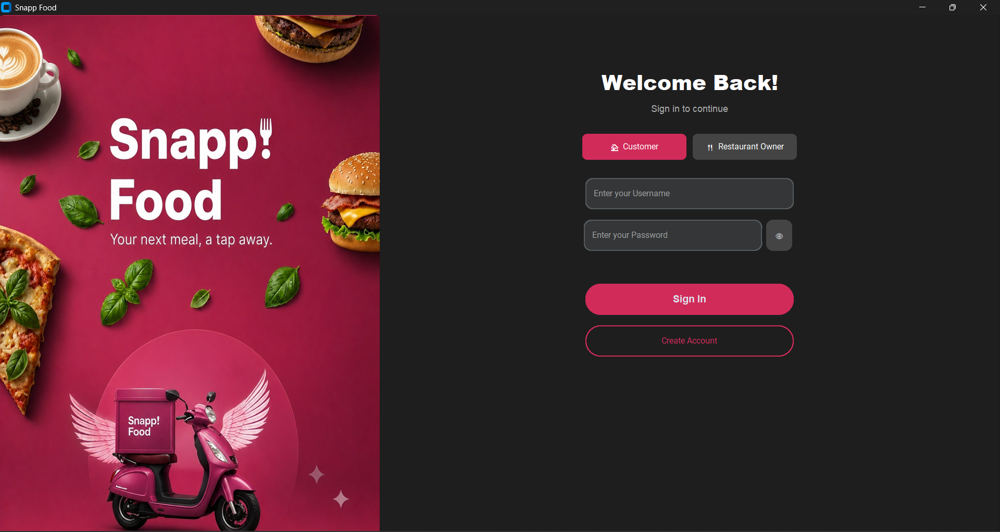
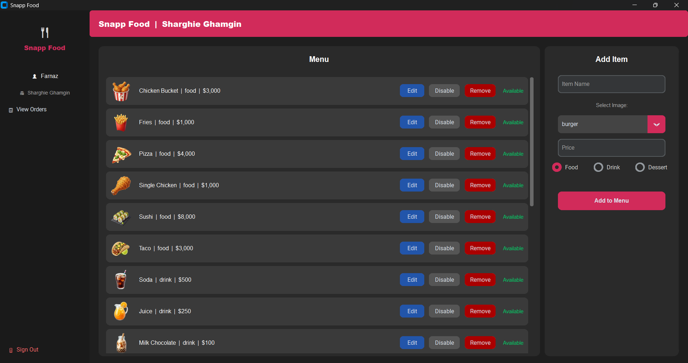
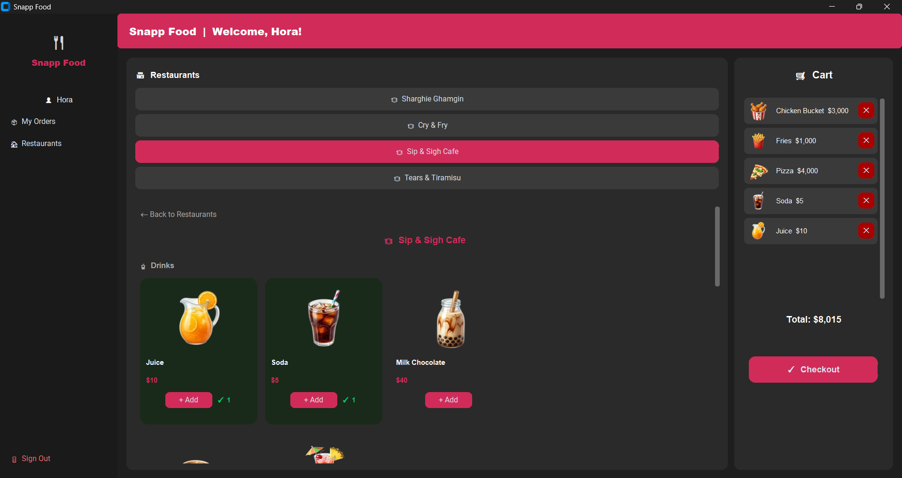
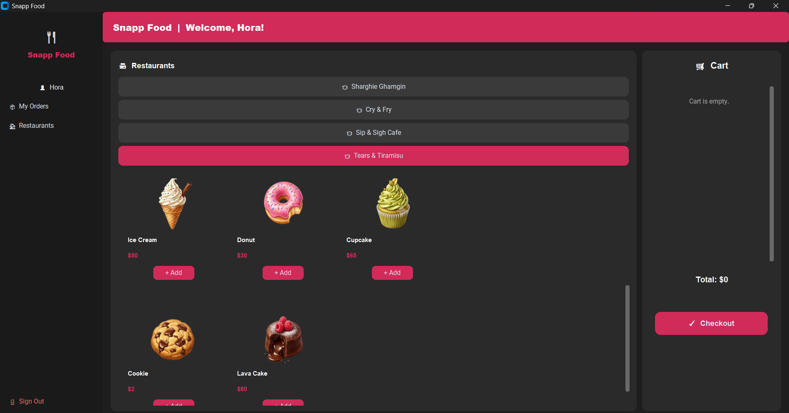
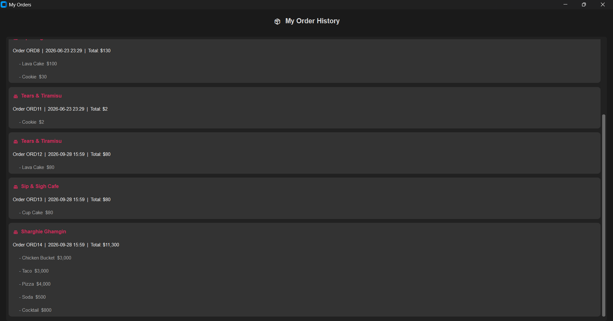

# 🍔 Snapp! Food — Restaurant Management & Ordering System


A modern **desktop application** for online food ordering and restaurant management, built with **Python** and **CustomTkinter**.  
Two roles – **Restaurant Owner** 👨‍🍳 and **Customer** 🛍️ – with full visual menu management, live shopping cart 🛒, and order receipt tracking 📦.  
Sleek **dark theme** 🌙 with vibrant **pink accents** 🌸, powered by persistent **SQLite** database storage.

---

## 🎥 Video Walkthrough

> 🎬 *Watch the full live demonstration of Snapp! Food in action:*

<!-- VIDEO_HERE -->

---

## 📷 Screenshots

<table>
  <tr>
    <td align="center" width="50%">
      
      <br />
      <em>Split-screen welcome & role-based sign-in window</em>
    </td>
    <td align="center" width="50%">
      
      <br />
      <em>Restaurant Owner panel with visual menu CRUD & status controls</em>
    </td>
  </tr>
  <tr>
    <td align="center" width="50%">
      
      <br />
      <em>Customer dashboard with categorized items and live shopping cart</em>
    </td>
    <td align="center" width="50%">
      
      <br />
      <em>Visual food & dessert cards with instant add-to-cart badges</em>
    </td>
  </tr>
  <tr>
    <td colspan="2" align="center">
      
      <br />
      <em>Detailed customer order history with timestamps and itemized receipts</em>
    </td>
  </tr>
</table>

---

## 🚀 Features

### 🔒 User Management
* Sign up and sign in as **Restaurant Owner** 👨‍🍳 or **Customer** 👤
* Modern split-screen login interface with promotional graphics 🎨
* Password visibility toggle 👁️ and input validation

### 👨‍🍳 Restaurant Owner Dashboard
* View restaurant menu items with visual food icons, categories, and prices 💲
* **Add** ➕ / **Edit** ✏️ / **Remove** 🗑️ menu items across categories (Food 🍔, Drink 🥤, Dessert 🧁)
* Toggle item status between **Available** 🟢 and **Disable** ⚪ in real time
* Built-in image selector using high-quality food assets 🖼️
* View all customer orders placed at the restaurant 📋

### 🛍️ Customer Dashboard
* Browse a list of registered restaurants and cafes 🏪
* Explore visual menu cards with real-time availability and pricing
* Add items to the interactive **Cart** 🛒 with item counters (`✓ 1`) and instant removal (`✕`)
* **Checkout** ✔️ to place orders with automatic total calculation
* View complete **Order History** 📦 grouped by restaurant with order IDs and exact timestamps 🕒

---

## 🗂️ Project Architecture

```text
Snapp_Food/
├── assets/               # Graphical banner and food item icons
├── gui/
│   └── app.py            # CustomTkinter dark-themed UI & dashboards
├── models/               # Object-Oriented domain models
│   ├── menu_item.py      # MenuItem class and item attributes
│   ├── order.py          # Order calculation and receipt handling
│   └── restaurant.py     # Restaurant logic and menu management
├── screenshots/          # Application screenshots for documentation
├── app_platform.py       # Core platform state & controller
├── data_manager.py       # SQLite database initialization & queries
├── main.py               # Application entry point
├── requirements.txt      # External Python dependencies
├── LICENSE               # MIT License
└── README.md             # Project documentation
```

---

## ⚙️ Installation & Usage

1. **Clone the repository:**
```bash
   git clone https://github.com/FarnazZS/Snapp_Food.git
   cd Snapp_Food
```

2. **Install required packages:**
```bash
   pip install -r requirements.txt
```

3. **Run the application:**
```bash
   python main.py
```

---

## 💻 Technologies

* **Python 3** – core programming language
* **CustomTkinter** – modern dark-themed GUI framework
* **Pillow (PIL)** – image processing and custom icon rendering
* **sqlite3** – built-in relational SQLite database management
* **Modular OOP** – clean separation between UI (`gui`), business logic (`models`), and persistence (`data_manager`)

---

## 💡 Future Enhancements

- [ ] Dynamic sales charts and analytics dashboard for restaurant owners
- [ ] Upload real food images from local disk for menu items
- [ ] Dark/Light mode toggle with customizable accent colors
- [ ] Animated UI transitions for adding items to the cart
- [ ] User profile avatars and saved favorite meals
- [ ] Receipt generation as shareable graphical tickets

---

## 📜 License

This project is licensed under the **MIT License** – see the [LICENSE](LICENSE) file for details.

<div align="center">
  <sub>Developed by <a href="https://github.com/FarnazZS">Farnaz Zarrabi Shirabad</a></sub>
</div>